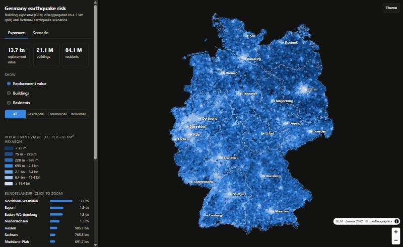
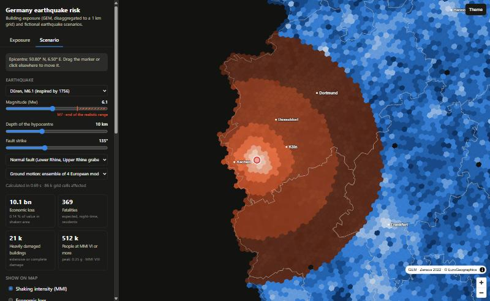
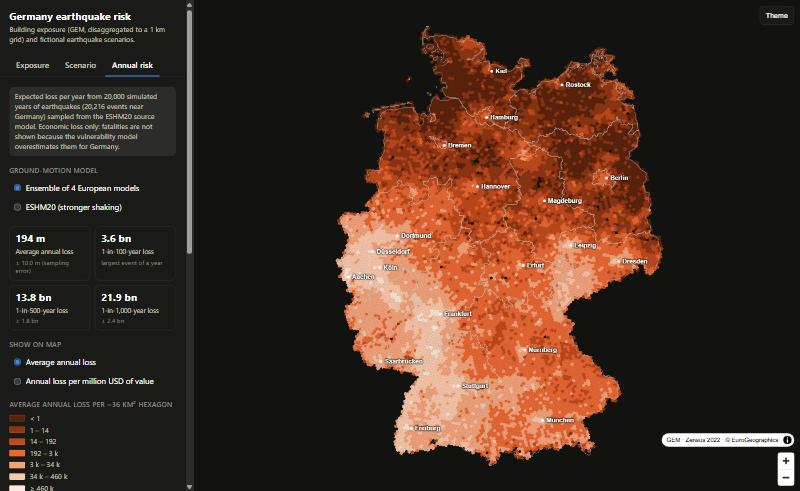
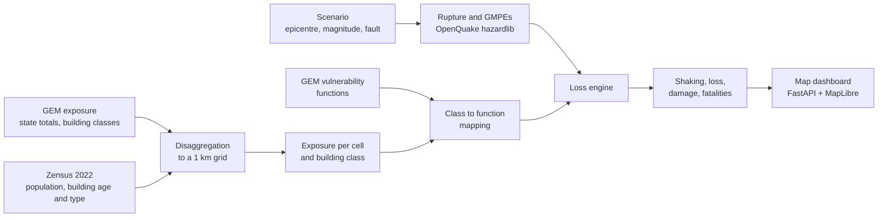

# Germany Earthquake Risk

Scenario earthquake damage and risk for Germany: place a fictional earthquake on the map, choose its magnitude, and get
the shaking, the economic loss, the damage to buildings and the expected fatalities in about a second.

The building exposure comes from the [Global Earthquake Model (GEM)](https://www.globalquakemodel.org/) and is
disaggregated to a 1 km grid with the 2022 census. Ground motion and losses are computed with the
[OpenQuake](https://github.com/gem/oq-engine) hazard library and GEM's vulnerability functions, and checked against the
full OpenQuake engine.





## What it does

- **Exposure map.** 21 million buildings, USD 13.7 trillion replacement value and 84 million residents on a hexagon map,
  split by residential, commercial and industrial buildings, with the state totals of GEM reproduced exactly.
- **Scenario dashboard.** Click the map to set the epicentre (and drag it), pick magnitude (4.5-8), depth, strike and fault
  type, and see shaking intensity, economic loss, loss ratio and fatalities per hexagon, plus damage grades and losses by
  component, building type and federal state. Six example scenarios are included.
- **Annual risk.** A stochastic event set of 20,000 simulated years is sampled from the ESHM20 source model with
  OpenQuake and run through the loss engine. The dashboard shows the average annual loss per hexagon and federal
  state and the loss that is exceeded once in 100, 500 and 1,000 years, for two ground-motion models.
- **Command line.** `quakerisk scenario ...` prints the scenario results as JSON; `quakerisk eventset`,
  `eventlosses` and `riskmetrics` run the probabilistic risk pipeline.

## How it works



1. **Exposure** (`quakerisk.exposure`): GEM publishes the exposure of Germany only per federal state. It is spread to
   the Zensus 1 km cells: residential buildings follow the census counts by construction decade and building type;
   GEM's 77 residential building classes are assigned per cell by iterative proportional fitting, so the national class mix
   is reproduced exactly. Commercial and industrial buildings are not in the census grid: industrial ones are spread by the
   industrial land of CORINE Land Cover, commercial ones by population.
2. **Vulnerability** (`quakerisk.vulnerability`): the 169 exposure classes are mapped to GEM's 82 vulnerability functions
   by attribute distance (material, structural system, seismic design level, ductility, height).
3. **Hazard** (`quakerisk.hazard`): a finite rupture and the ground motion (PGA, SA at 0.3 / 0.6 / 1.0 s) of an ensemble
   of four European GMPEs at every cell. The ESHM20 model is available as a stronger-shaking option.
4. **Loss** (`quakerisk.engine`): expected loss ratios per vulnerability function, integrated over the ground-motion
   variability (truncated at 3 sigma), give structural, non-structural and contents losses, fatalities and damage grades.
5. **Annual risk** (`quakerisk.eventset`, `eventloss`, `riskmetrics`): OpenQuake samples a stochastic event set from
   the ESHM20 source model (area, smoothed-seismicity and fault sources, 100 logic-tree paths); every event near
   Germany is run through the loss engine in parallel. The event loss table gives the average annual loss and the
   exceedance curves; losses are also accumulated per 1 km cell for the map.
6. **Dashboard** (`quakerisk.server`, `web/`): a FastAPI backend and a single-page MapLibre front end.

More detail, assumptions and decisions are in [project-execution.md](project-execution.md).

## Quick start

Requires Python 3.10-3.12 (developed and tested with 3.12 on Windows 11). About 150 MB of input data is stored (the industrial land is fetched with a filtered web query of about 40 MB); building takes a few minutes.

```bash
python -m venv .venv
.venv\Scripts\activate            # Linux / macOS: source .venv/bin/activate
pip install -e .
pip install openquake.engine==3.26.2 --no-deps    # hazard library; its GDAL dependency is not needed

quakerisk download                # GEM data, Zensus 2022 grid tables, state boundaries, industrial land -> data/raw
quakerisk build                   # exposure -> vulnerability mapping -> engine data -> web page
quakerisk serve                   # dashboard at http://localhost:8000
```

Run a scenario without the dashboard, for example an M6.0 normal-faulting earthquake near Düren:

```bash
quakerisk scenario --lon 6.5 --lat 50.8 --mag 6.0 --depth 10 --strike 135
```

On Windows, keep the project in a short path (or enable long paths): installing `openquake.engine` fails when the
virtual environment lies in a deeply nested folder.

The annual-risk results need two more commands (about 2 minutes for the event set and 10 minutes per ground-motion
model on 16 cores), after which `quakerisk web` adds the risk tab to the page:

```bash
quakerisk eventset --years 20000 --samples 100 --name es20k   # ESHM20 event set (needs the OpenQuake engine)
quakerisk eventlosses --name es20k --gmpe ensemble            # loss of every event; also --gmpe eshm20
quakerisk riskmetrics --name es20k --gmpe ensemble            # average annual loss, exceedance curves
quakerisk web
```

`quakerisk build` runs four steps that can also be run one at a time: `quakerisk exposure`, `quakerisk vulnerability`,
`quakerisk engine`, `quakerisk web`. Opening `web/index.html` without the backend still shows the exposure map.

### Tests

```bash
pip install -e ".[dev]"
pytest                            # needs the built data (quakerisk download && quakerisk build)
ruff check src tests validation
```

## Project layout

```
src/quakerisk/
  download_data.py   download of the open input data
  exposure.py        disaggregation of the GEM exposure to the 1 km grid
  vulnerability.py   GEM vulnerability functions and the class-to-function mapping
  hazard.py          rupture, ground-motion models, shaking intensity
  engine_data.py     exposure matrices (cell x vulnerability function) for the engine
  engine.py          scenario loss engine
  eventset.py        stochastic event set from the ESHM20 source model (OpenQuake)
  eventloss.py       loss of every event of an event set, per-cell average annual loss
  riskmetrics.py     average annual loss and exceedance curves
  webdata.py         hexagon aggregation and assembly of web/index.html
  server.py          FastAPI backend
  cli.py             the `quakerisk` command
web/                 template.html, style.css, app.js (index.html is generated)
tests/               pytest tests
validation/          comparison with the OpenQuake engine (scripts, results, README)
data/                raw and processed data (generated, not tracked)
project-execution.md how the project was built: decisions, assumptions, caveats
```

## Validation

The loss engine was compared with the OpenQuake engine (`scenario_risk`) on identical inputs: same rupture, same
1.3-1.8 million exposure assets, same vulnerability functions, one GMPE and 500 sampled ground-motion fields.

| Scenario | OpenQuake loss | This engine | Ratio | OpenQuake Monte-Carlo error |
|---|---|---|---|---|
| Düren, M5.8, 10 km depth | USD 3.58 bn | USD 3.68 bn | 1.03 | 2.2 % |
| Munich, M5.5, 8 km depth | USD 7.23 bn | USD 7.37 bn | 1.02 | 2.6 % |

Median ground motion agrees within 4 %, per-cell losses lie on the 1:1 line. See [validation/README.md](validation/README.md).
The stochastic event set was checked against OpenQuake's classical PSHA: with the full ESHM20 ground-motion tree the
exceedance rates agree within about 10 % (point ruptures, as ESHM20 models its sources) and the PGA with a 475-year
return period within 2 % (median over sites).
This validates the calculation, not the inputs: the exposure disaggregation, the class mapping and the vulnerability
model themselves are not checked against observed damage.

## Limitations

This is a modelling exercise, not a risk assessment.

- **Order-of-magnitude estimates.** For the 1978 Albstadt earthquake (M5.7) the model gives about USD 2 billion and about
  100 fatalities, whereas the real event caused far less damage and no deaths. The scenarios are useful for comparing
  events, not as forecasts. Germany's strongest known earthquakes are around M6; the dashboard warns above M7.
- **Disaggregation.** GEM's finer exposure is not public, so the spatial distribution is modelled. Commercial buildings
  are spread by population (a proxy). Industrial buildings follow CORINE industrial land, but about 9 % of that land lies
  in cells without residents, which the census-based grid does not contain. Both share one national class mix.
- **Annual risk.** The average annual loss is about USD 194 million (ensemble ground motion) to 244 million (ESHM20),
  from 20,000 simulated years; the 1-in-500-year loss is about USD 14-17 billion. These are model results that have
  not been compared with published figures. Only the central branch of ESHM20's ground-motion tree is used for the
  losses, ESHM20 gives no fault orientation for its point sources (a random strike is drawn), and expected fatalities
  (about 8-10 per year) are far too high compared with the historical record, so the dashboard shows only economic loss.
- **No fragility curves.** The public GEM data has only vulnerability functions; the damage grades are derived from the
  loss-ratio distribution.
- **Assumptions.** Uniform soil (Vs30 = 400 m/s, no site effects); structural share of the building cost 30 % (residential)
  and 25 % (commercial, industrial); fatalities for residents at night only.

## Data and attribution

Derived data in this project is non-commercial because the GEM data is licensed CC BY-NC-SA 4.0.

- **Exposure:** Yepes-Estrada, C. et al. (2026), *Global Exposure Model* v2026.0.0, GEM Foundation,
  [doi:10.5281/zenodo.8117363](https://doi.org/10.5281/zenodo.8117363), CC BY-NC-SA 4.0.
- **Vulnerability:** Nafeh, A.M.B., Aljawhari, K., Silva, V. (2025), *The 2025 Global Vulnerability Model of the GEM
  Foundation*, <https://github.com/gem/global_vulnerability_model>, CC BY-NC-SA 4.0.
- **Census grid data:** Statistische Ämter des Bundes und der Länder, Zensus 2022
  ([zensus2022.de](https://www.zensus2022.de)); aggregated and modified here.
- **Boundaries:** © EuroGeographics for the administrative boundaries, Eurostat / GISCO NUTS 2021.
- **Seismic hazard model:** Danciu, L. et al. (2021), *The 2020 update of the European Seismic Hazard Model: Model
  Overview*, EFEHR Technical Report 001, [doi:10.12686/a15](https://doi.org/10.12686/a15); OpenQuake input files:
  [doi:10.12686/eshm20-oq-input](https://doi.org/10.12686/eshm20-oq-input), CC BY 4.0. Downloaded from the EFEHR repository
  (<https://gitlab.seismo.ethz.ch/efehr/eshm20>), not redistributed here.
- **Land cover:** CORINE Land Cover 5 ha, status 2018 (CLC5 2018), © Bundesamt für Kartographie und Geodäsie (BKG),
  Datenlizenz Deutschland - Namensnennung 2.0; only the industrial polygons were used, aggregated and modified here.
- **Hazard and risk software:** [OpenQuake engine and hazard library](https://github.com/gem/oq-engine), GEM Foundation
  (AGPL-3.0).
- **Map components:** [MapLibre GL JS](https://maplibre.org/) and [h3-js](https://github.com/uber/h3-js), loaded from a CDN
  when the page opens; no map tiles are used.
